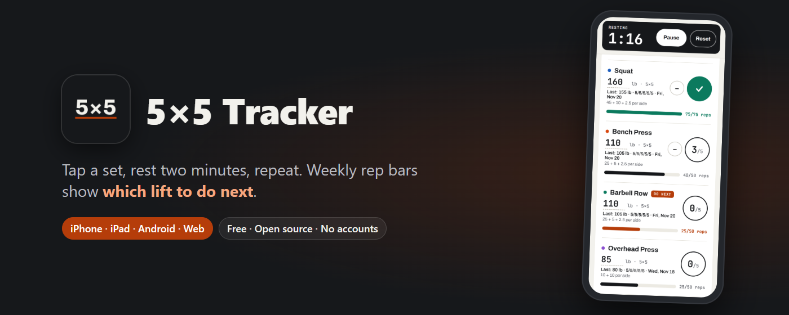

# 5×5 Tracker

[](https://icodeforbananas.github.io/five-by-five-tracker/)

A no-nonsense tracker for the classic 5×5 strength program, built with Expo (React Native + TypeScript) for **iOS, Android and the web** from one codebase.

**Use it in a browser:** <https://icodeforbananas.github.io/five-by-five-tracker/>

- **Weekly rep targets**: each lift has a progress bar of reps in the last 7 days against a weekly target (the A/B rotation done three times a week: squat 3 sessions, the others 2, so 75 reps for squat, 50 for bench/row/OHP, 10 for deadlift). The lift furthest behind is flagged **Do next**. Targets are `WEEKLY_SESSIONS` in `src/lib/program.ts`.
- **Any lift, any day**: all five lifts (Squat, Bench, Row, Overhead Press, Deadlift) are always listed, each with what you did last time (weight, reps, date). Nothing forces Workout A or B; finishing logs only the lifts you counted sets for.
- **Tap-to-count sets**: tap a lift's counter each time you finish a set (− takes one back). It stops at the lift's set count.
- **Rest timer pinned at the top**: tap it to start a 2:00 countdown; while running it shows Pause and Reset. The screen stays awake while it runs.
- **Automatic progression**: hit every rep and the weight goes up 5 lb (10 lb on deadlift). Miss and you repeat the weight. Three misses in a row deloads 10%.
- **Working weights**: tap a lift's weight to type a new one; each lift shows the plates per side for a 45 lb bar.
- **Progress chart**: per-lift lines with solid dots (all reps hit) and hollow dots (missed reps). Tap a chip to show or hide a lift.
- **History** with undo of the last session, plus a reset-all link at the bottom.

All data stays on the device (AsyncStorage; in a browser that's local storage). There are no accounts, no network calls, and no runtime permissions.

## Download

| Platform | How |
|---|---|
| Web | <https://icodeforbananas.github.io/five-by-five-tracker/> (rebuilt on every push to `main`) |
| Android | The `.apk` on the [latest release](../../releases/latest), or the `FiveByFive-android` artifact of the latest [CI run](../../actions/workflows/ci.yml) |
| iOS | Sideload the unsigned `.ipa` from the latest [CI run](../../actions/workflows/ci.yml), or build through EAS (below) |

## CI and releases

- **CI** (`.github/workflows/ci.yml`), on every push and pull request: typecheck, lint, web export, then an Android APK and an unsigned iOS `.ipa`, both attached to the run.
- **Pages** (`pages.yml`), on every push to `main`: publishes the web export to GitHub Pages. `app.config.ts` sets the web base path from `EXPO_BASE_URL` so the site works under `/five-by-five-tracker/`; local dev is unaffected.
- **Release** (`release.yml`), on a `v*` tag (`git tag v1.1.0 && git push origin v1.1.0`): builds the APK and attaches it to a GitHub release.

## Project layout

```
src/
  app/            expo-router routes (_layout.tsx = fonts/splash/repository provider, index.tsx = tracker screen)
  components/     WorkoutCard, RestTimerBar, ProgressChart, HistoryList
  hooks/          useTracker: app state + intent-level actions (finish, undo, countSet, …) + timer clock
  lib/program.ts  program rules and pure state transitions, with no storage or React code
  services/       persistence layer (see below)
  theme.ts        colors and font families
assets/           app icon, Android adaptive icon layers, splash, favicon
```

## Data and persistence

The UI never touches storage. Screens call `useTracker()` actions; each action applies a pure transition from `lib/program.ts`, then persists only the parts that changed through the **`WorkoutRepository`** interface (`src/services/WorkoutRepository.ts`):

| Method | Called when |
|---|---|
| `load()` | app start (runs schema migrations) |
| `saveProgram({ lifts, next })` | weight edited (`next` is the legacy A/B pointer, kept for compatibility) |
| `saveDraft(reps)` | a set is counted or taken back |
| `savePreferences({ hidden })` | a chart line is toggled |
| `saveTimer({ timerEnd, timerLeft })` | the rest timer starts, pauses, or resets |
| `recordSession(session, program)` | a workout is finished (one atomic write) |
| `removeSession(id, program)` | "Undo last session" |
| `clear()` | "Reset all data" |

The current implementation, `AsyncStorageWorkoutRepository`, stores one JSON document under the key `five-by-five-tracker`. It's versioned by `src/services/schema.ts`:

- `schemaVersion` (currently **2**) and `updatedAt` on every write.
- Sessions carry a UUID `id` (from `expo-crypto`) so they can be deduplicated when syncing.
- `migrate()` upgrades older documents step by step. v1 is the original flat format under `five-by-five-tracker-v1`, which is moved to the new key on first load. To change the stored shape, bump `SCHEMA_VERSION` and add a `MIGRATIONS[n]` step.
- If the stored data has a *newer* schema than the app understands (a downgraded build), loading fails with a visible message and nothing is written, so newer data is never clobbered.

### Future: syncing to a backend

To move to Supabase or any other backend:

1. Write a class that implements `WorkoutRepository`, e.g. `SupabaseWorkoutRepository`. Sessions map to rows keyed by `id`; `program`, `preferences`, and `draft` map to per-user rows. The timer can stay device-local.
2. Return it from `createWorkoutRepository()` in `src/services/index.ts`. That one line is the only change outside `src/services/`.
3. For offline-first sync, wrap both, for example a `SyncingWorkoutRepository` that writes locally first and pushes to the remote in the background, using `updatedAt` and session `id`s to reconcile.

No backend SDKs, keys, or environment variables are set up yet.

## Setup

Requirements: Node **22.13+** (Expo SDK 58), npm, and an [Expo account](https://expo.dev/signup) for EAS builds.

```bash
npm install
npm start            # Expo dev server
npm run web          # run it in a browser
npm run build:web    # static web export to dist/
npm run typecheck    # tsc --noEmit
npm run lint         # expo lint
npm run doctor       # expo-doctor
```

The app uses native modules that ship with Expo Go (svg, async-storage, haptics, keep-awake), so `npm start` and scanning the QR code with Expo Go works for quick iteration. For a build that matches production, use a development build (below). `npm run web` also runs it in a browser.

## Building with EAS

App identifiers live in `app.json`:

| | |
|---|---|
| Display name | 5×5 Tracker |
| iOS bundle ID | `com.michaelcalkins.fivebyfivetracker` |
| Android package | `com.michaelcalkins.fivebyfivetracker` |

These identifiers are permanent once you publish to either store, so change them before the first submission if you want something different.

One-time setup:

```bash
npx eas-cli@latest login
npx eas-cli@latest init        # links the project and writes extra.eas.projectId into app.json
```

Build profiles (`eas.json`):

| Profile | Use | Command |
|---|---|---|
| `development` | Dev client; iOS simulator build, internal Android APK | `npx eas-cli@latest build --profile development --platform all` |
| `preview` | Internal testing (ad hoc iOS, Android APK) | `npx eas-cli@latest build --profile preview --platform all` |
| `production` | Store builds (iOS .ipa, Android .aab) | `npx eas-cli@latest build --profile production --platform all` |

Version numbers use `appVersionSource: "remote"`, and `production` builds auto-increment the iOS build number and Android versionCode. Bump `expo.version` in `app.json` for each user-facing release.

## Local release APK (sideloading)

For a quick install on an Android phone without EAS. Needs JDK 17 and the Android SDK; Gradle downloads the NDK and CMake on first build.

```bash
npx expo prebuild --platform android
cd android
ANDROID_HOME="$LOCALAPPDATA/Android/Sdk" ./gradlew assembleRelease -PreactNativeArchitectures=arm64-v8a,armeabi-v7a
# → android/app/build/outputs/apk/release/app-release.apk
```

- **Signing:** the generated project signs release builds with the template's `android/app/debug.keystore`. That's fine for sideloading but can't be uploaded to Google Play; store builds go through EAS, which manages the real upload key.
- **Windows path limit:** native object paths exceed 260 characters when the repo is nested deeply. `plugins/withCmakeObjectPathMax.js` makes CMake hash the app's long paths, but library builds such as `react-native-worklets` can still fail. Build from a short path (for example a copy of the repo at `C:\b5`) or enable Windows long-path support.

## Submitting to the stores

### Apple App Store

1. Join the Apple Developer Program ($99/yr).
2. In App Store Connect, create the app with bundle ID `com.michaelcalkins.fivebyfivetracker`. EAS can register the bundle ID and create signing credentials during the first build.
3. `npx eas-cli@latest build --profile production --platform ios`
4. `npx eas-cli@latest submit --platform ios --latest`. The first run prompts for your Apple ID and the App Store Connect app, or you can set `ascAppId` under `submit.production.ios` in `eas.json`.
5. In App Store Connect, add screenshots, a description, and a privacy policy URL. Privacy "nutrition label": **Data Not Collected**. Then submit for review. Export compliance is already declared (`usesNonExemptEncryption: false`).

### Google Play

1. Create a Google Play Console account ($25 one-time).
2. Create the app in Play Console. The first upload of a new app **must be done manually**: build with `npx eas-cli@latest build --profile production --platform android` and upload the `.aab` to an internal testing track.
3. For later uploads, create a Google Cloud service account with Play Console access, download its JSON key (it's git-ignored if you name it `*.json` under a `secrets/` folder; never commit it), and set `serviceAccountKeyPath` under `submit.production.android` in `eas.json`. Then run `npx eas-cli@latest submit --platform android --latest`.
4. Complete the store listing, content rating, target audience, and Data safety form (**no data collected or shared**), then promote to production.

## Notes

- The rest timer counts down from a stored end timestamp, so it stays accurate if the app is backgrounded. It doesn't post a notification when time is up, which keeps the app permission-free. Adding `expo-notifications` would make that possible.
- `ios/` and `android/` are generated (Continuous Native Generation) and git-ignored. Configure native behavior through `app.json`, not by editing those folders.
- MIT licensed; see `LICENSE`.
